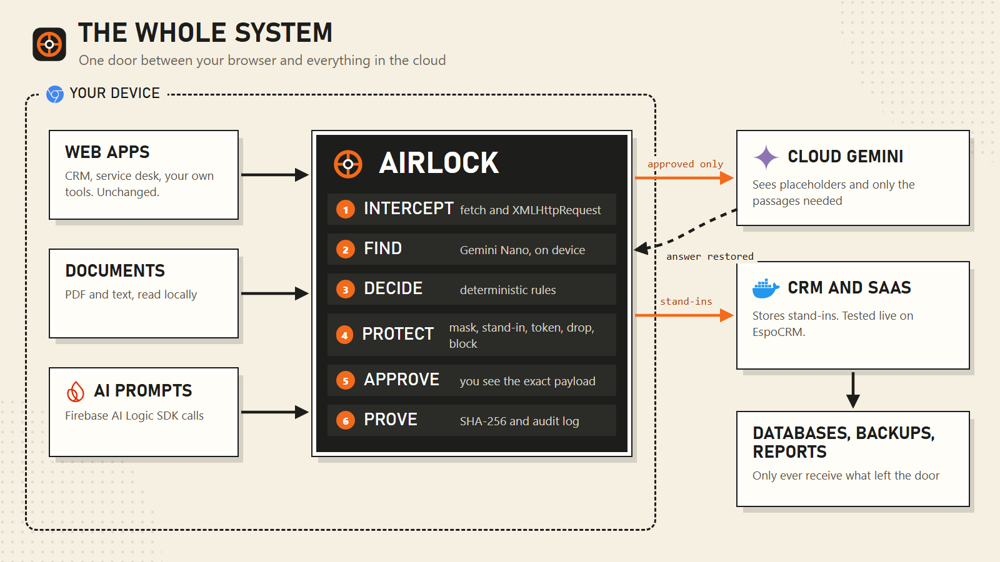
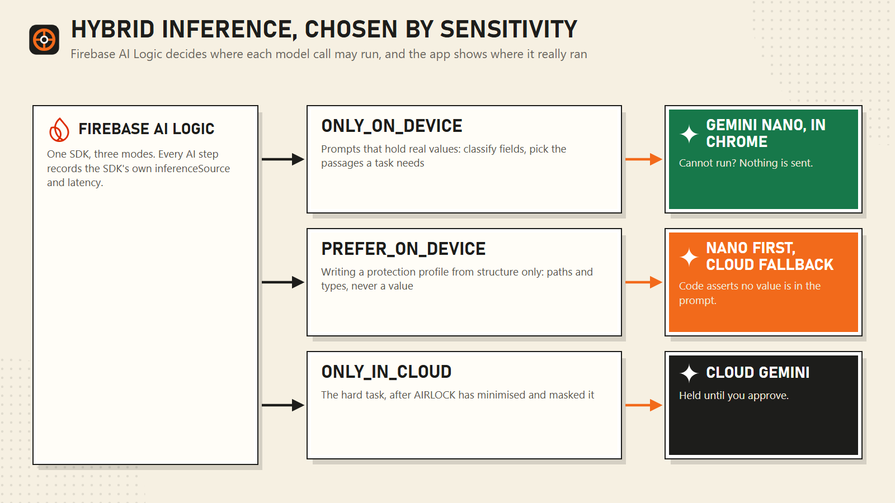
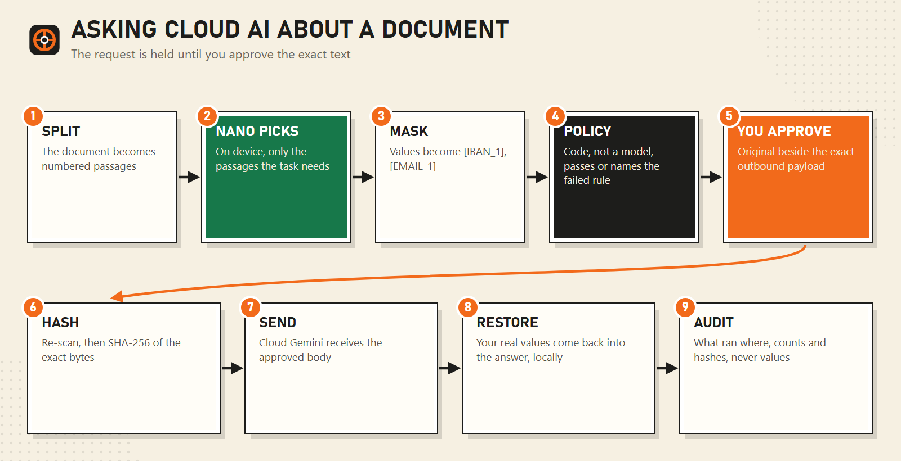
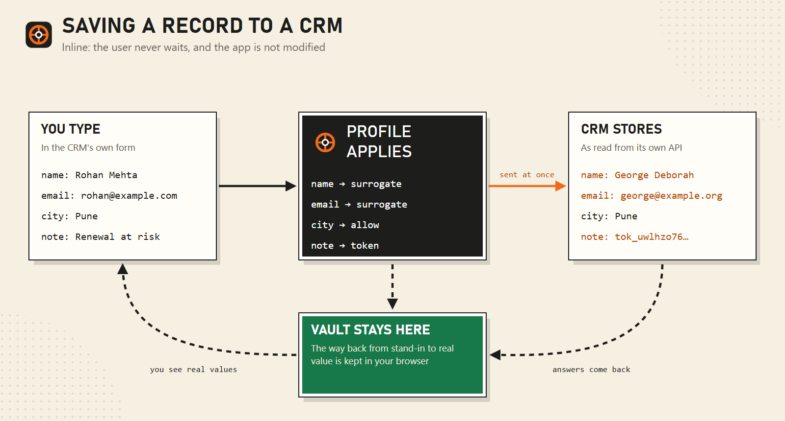
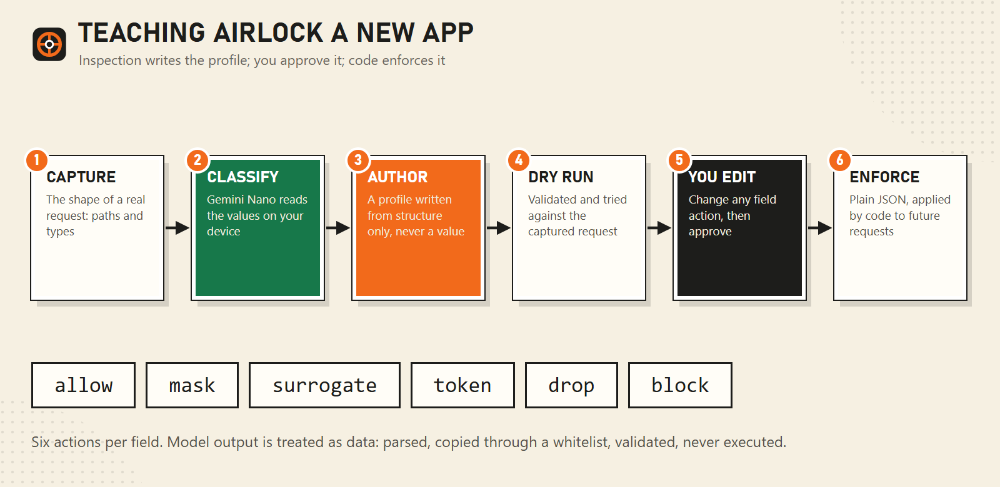
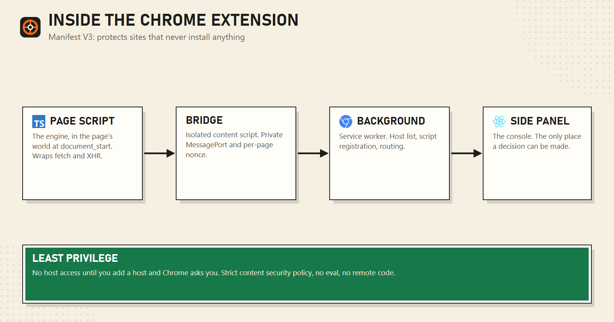

# Architecture

AIRLOCK is a programmable data-protection boundary for AI and SaaS traffic in the browser: *give cloud AI only what it needs, and prove what it received.* Page `fetch` and `XMLHttpRequest` calls to hosts you list are held, protected field by field according to a **profile** (plain JSON), shown to you as the exact outbound payload, and sent only after approval. The same engine runs in a web app (`installAirlock()`) and, bundled separately, in a Chrome extension.

AIRLOCK has one engine and two kinds of profile. The built-in `gemini-generate-content` profile runs the original clause-minimizing pipeline (`ai-minimize`, described first). Any other SaaS host runs the `field-protect` pipeline from a **profile**: plain JSON that says which request and response fields matter and what to do with each. A profile can be written by hand, or authored by hybrid inference from a captured request (see "Profile-driven engine" below).

## At a glance

<p align="center"></p>

<p align="center"></p>

## The two flows

<p align="center"></p>

<p align="center"></p>

## The Gemini path (profile `gemini-generate-content`, pipeline `ai-minimize`)

```
 Host app (src/host)                     AIRLOCK (src/airlock)                       Cloud
 ───────────────────                     ─────────────────────                       ─────
 cloudModel.generateContent([task, doc])
        │  Firebase AI Logic SDK
        ▼
   fetch(POST …:generateContent)  ──►  net/guard.ts (wrapped fetch)
                                         1. host allowlist? no → pass through untouched
                                         2. streaming / non-text / odd shape → BLOCK
                                         3. core/clauses     split document → C1..Cn
                                         4. ai/local         Gemini Nano (ONLY_ON_DEVICE, JSON schema)
                                                             proposes needed clauses  [on-device]
                                         5. core/injection   instruction-like clauses withheld
                                         6. core/detect+vault mask values → [EMAIL_1] …
                                         7. core/policy      deterministic rules → PASS or named failure
                                         8. inspector        original vs EXACT outbound text, Approve/Deny
                                         9. re-scan + SHA-256 of the exact body
                                        10. send approved body ───────────────────────►  Gemini (in cloud)
        ◄──────────── answer restored  ◄─────  11. restore placeholders in the response ◄─────
        │                                       12. audit log: where each step ran, what left, what was blocked
        ▼
   host app shows the answer
```

## Profile-driven engine

Adapters turn what the page is about to send into one normalized request; `engine.process` decides; the adapter obeys.

```
 fetch  ─► net/guard.ts ──┐
                          ├─► net/engine.ts  process(req)
 XHR    ─► net/xhr.ts  ───┘     1. host in scope? (hosts of profiles, plus an explicit scope list) no → pass through untouched
                                2. body not text (FormData, Blob, ArrayBuffer ...) → BLOCK with the type named
                                3. profiles/match   first matching profile wins: stored and authored first, built-ins last
                                4. no match, CRM/SaaS destination (inline) → MASK with the detectors and SEND; capture for authoring; flag for review
                                   no match, AI or strict destination      → BLOCK: "No profile matches ..." (fail closed)
                                5. profile.pipeline:
                                   ai-minimize   the Gemini path above
                                   field-protect flows/protect: every located field gets its action
                                                 (profile flow, else destination default by category, else detected-value mask),
                                                 then a RESIDUAL SCAN over every other string leaf: a detector hit in a category
                                                 whose action is not allow, or a removed original anywhere, blocks the request
                                6. destination rules (editable JSON): ai hosts ask first, saas hosts send automatically
                                7. persist what restore needs (awaited), re-scan the exact outbound text, hash it, audit, send
                                8. response: restore placeholders, surrogates and tokens at the profile's response locators
```

Actions are `allow`, `mask` (vault placeholder such as `[EMAIL_1]`), `surrogate` (a realistic fake from the vendored DocCloak session), `token` (a stable `tok_` keyed token), `drop` and `block`. Locators are a small JSONPath subset implemented in the repo (`$`, `.key`, `['key']`, `[n]`, `[*]`), with no recursive descent, filters or slices.

## Authoring flow (an unprofiled in-scope host with inspection on)

<p align="center"></p>

```
 request held in memory, nothing sent ──► inspect/capture   every leaf: path, type, detector hits, a SHAPE-ONLY preview
        │
        ▼
 inspect/classify   ONLY_ON_DEVICE (Gemini Nano), JSON schema. Sees the real values on this device.
                    Counted as on_device only when response.inferenceSource says so; otherwise a labelled detector-only fallback.
        ▼
 inspect/prompt     STRUCTURE-ONLY prompt: paths, value types, classes and shape previews. Never a value.
                    assertStructureOnly proves no captured value is in it before every call; a leak means no call is made.
        ▼
 inspect/author     PREFER_ON_DEVICE: Nano first, automatic cloud fallback through the SDK. Safe only because of the step above.
                    The reply is DATA: size-capped, JSON-parsed, copied through a whitelist into a fresh object, validated
                    (caps, host names only, locator subset, no widening of scope), then DRY-RUN against the captured request.
                    One feedback retry (paths and rules only). response.inferenceSource and latency are recorded and shown.
        ▼
 user edits per-field actions, then Approve ─► approve re-runs validation and the dry run, then saves. Only approval saves. The profile applies to FUTURE requests.
        ▼
 on an inline destination the captured request was already sent masked; on a strict destination it is released with "Profile saved. Send the request again to use it."
```

If the SDK falls back to the cloud for authoring, the engine releases exactly that one request, and only when its body equals the registered value-free prompt and generation config (`engine.allowStructureOnly`); it is audited as `internal-authoring`. Any other Gemini request stays held for approval. The one-time "Send once unprotected" button is the only way a held request leaves unprotected; it is audited as `unprotected-send` and counted in "Left this device".

## The console

`src/airlock/ui/console/` is a React console designed with Google Stitch (a light, airy look) and re-implemented by hand in plain CSS (`tokens.css`, `console.css`; no UI framework, Plus Jakarta Sans and IBM Plex Mono bundled locally, Lucide icons as inline SVG). It reads the engine only through four interfaces, `store` (requests and decisions), `audit`, `registry` (profiles and rules) and `inspection`, so the same components run beside the web app and in the extension's side panel (see below). Six pages, hash-routed: **Overview** (what is held, sent and blocked), **Traffic** (every request, with a request page showing original against exact outbound payload, the policy checks, the wire hash and the restored answer), **Profiles** (view, edit, import and export profile JSON), **Policies** (destination rules and the honest notes on what is and is not covered), **Inspection** (hold an unprofiled request, classify on-device, author and approve a profile) and **Audit** (what ran where, and an exportable receipt). The extension adds a **Hosts** page. Every label comes from data: `inferenceSource` is shown as the SDK reported it, and anything unmeasured reads "Not measured". The UI makes no enclave, attestation or zero-retention claim: none exists. The design contract that lists those excluded claims is an internal planning document; no automated test scans the UI strings for them.

## Chrome extension

<p align="center"></p>

```
page (MAIN world)  <-- MessagePort + per-page nonce -->  bridge (ISOLATED content script)
bridge             <-- chrome.runtime port -->           background service worker
background         <-- chrome.runtime port -->           side panel (extension page, React console)
```

- **Page (`src/ext/page/`).** The same engine (`installAirlock`, UI-free) runs in the page's own JavaScript world at `document_start`, so it wraps `fetch` and `XMLHttpRequest` before page code can capture them. `scopeOnly` makes the configured host list the only scope: a stored profile never pulls another host in. Every destination asks, whatever its kind. A `RemoteHost` publishes a snapshot (requests, audit, profiles, rules, inspection items, model state) and runs the validated commands the panel sends back.
- **Fail-closed gate (`failclosed.ts`).** A held request or inspection is denied, with a plain-words reason, when no panel is attached as it starts waiting, the panel port closes, the bridge stops answering liveness probes, or nobody answers within the hold timeout. The gate can only end a wait, never approve one.
- **Bridge (`src/ext/bridge/`).** Hands the page a private `MessagePort` and a nonce, relays to the background, answers liveness pings. It is the only part with a `chrome.runtime` connection from the page's tab.
- **Background (`src/ext/background/`).** Keeps the host list (`chrome.storage.local`), registers and unregisters the two content scripts per host that is both configured and granted, and routes frames to the panel by tab and frame. Its host API accepts messages only from the extension's own pages.
- **Side panel (`src/ext/panel/`).** `PanelClient` speaks the protocol; `createRemoteSource` gives the console (`src/airlock/ui/console`) the same store, audit, registry and inspection interfaces the web app passes, backed by snapshots and commands. The panel holds no engine and makes no cloud call. `createHostsController` validates a host name (`patternFromInput`), asks the browser for access inside the click, and stores the match pattern through the background.
- **Manifest.** Permissions `sidePanel`, `storage`, `scripting`; no `host_permissions` in the release build; `optional_host_permissions` for `http://*/*` and `https://*/*`, requested per host from the panel. Strict extension-page CSP; no `eval` and no remote code (a test scans the built bundles). The ID is pinned by a public key whose private half was discarded.

Trust boundaries, plainly:

- **The page is untrusted by the extension but shares the engine's world.** The engine runs in the page's JavaScript world to wrap its network calls, so a hostile page script could read what the page-side code can read, including the `localStorage` vault. The protection is the host list (nothing runs elsewhere), the hold-and-approve gate (a held request cannot proceed without a decision from the panel, or a timeout that denies), and the fail-closed paths. The handshake that pairs page and bridge cannot be authenticated from inside the page's world, so a page that wins a race to it could drive the panel's channel; the bridge listens first and a missing bridge blocks.
- **The panel is trusted.** It is an extension page, sees the originals of held requests, and is the only place a decision can be made. It talks to the background only.
- **The background routes, it does not interpret.** It validates every message shape and forwards snapshots and commands without reading values.
- **No App Check in the page.** The hybrid models are built lazily, without App Check; see [LIMITS.md](LIMITS.md) for what that means for the cloud authoring fallback.

## Modules

| Path | Role |
|---|---|
| `src/airlock/profiles/` | Profile contract and validator (`types`, `validate`), JSONPath subset (`jsonpath`), host and path matching (`match`), async KV storage and the registry (`storage`), built-ins (`builtins`) |
| `src/airlock/flows/` | The `field-protect` pipeline (`protect`), the six actions (`actions`), keyed tokens (`token`), persisted vault, surrogates and token index (`state`), destination rules (`rules`), the authoring dry run (`dryrun`) |
| `src/airlock/inspect/` | Capture with shape-only previews, on-device classification, the structure-only prompt and assertion, hybrid authoring with validation, and the inspection session store |
| `src/airlock/net/engine.ts` | The transport-agnostic engine: scope, matching, hold, structure-only release, pipelines |
| `src/airlock/learn/` | Value-free answer shapes (`shape`: keys and JSON types, never values, kept in memory) and deterministic response-locator proposals (`locators`), used by the inspection session |
| `src/airlock/flows/read.ts` | The allow-reads pipeline: a GET or HEAD with no body to a host whose destination rule the user set to allow reads, URL-scanned, audited and restored at the host's learned locators |
| `src/airlock/net/xhr.ts` | The XMLHttpRequest adapter (the same engine as fetch; synchronous XHR and non-text bodies to in-scope hosts are blocked) |
| `vite-plugins/mock-crm.ts` | **Stand-in** for Salesforce or HubSpot, served by the dev server only, with `/_raw` (what is stored) and `/_reset`. `crm-test.html` is its test page. Not a real CRM integration |
| `demo/espocrm/` | Docker compose for a **real** open-source CRM (EspoCRM, self-hosted, local only, throwaway demo credentials) used by `scripts/e2e-espocrm.mjs`. HubSpot and Salesforce were not tested |
| `src/airlock/core/clauses.ts` | Contiguous clause splitter with offsets and token estimates |
| `src/airlock/core/detect.ts` | Detection: vendored DocCloak rules, libphonenumber, secret rules, user-protected terms, identifier-shape guard |
| `src/airlock/core/vault.ts` | Reversible placeholders on the vendored DocCloak session |
| `src/airlock/core/policy.ts` | Deterministic disclosure rules (no model involved) |
| `src/airlock/core/injection.ts` | Heuristic for text that reads like instructions to an AI |
| `src/airlock/core/prepare.ts` | Minimize, mask, rebuild the body, run the policy; keyword fallback |
| `src/airlock/core/request.ts` | Parse and rebuild Gemini `generateContent` bodies; restore responses |
| `src/airlock/core/audit.ts` | Append-only audit log and the "left this device" summary |
| `src/airlock/net/guard.ts` | The fetch guard (the XHR adapter is `xhr.ts`; both call one engine) |
| `src/airlock/net/store.ts` | Observable request state and the approve, deny, fallback and demo decisions |
| `src/airlock/ai/local.ts` | Nano analyzer: batching, tolerant JSON extraction, retry, status |
| `src/airlock/ui/` | The console (`console/`: six pages, request page, kit, charts), its pure view-model code (`pages/`) and tokens and CSS |
| `src/ext/` | The Chrome extension: page script, bridge, background, side panel, protocol, build manifest |
| `src/eval/` | The deterministic evaluation corpus and test (`npm run eval`), and the dev-only harness page for the answer-quality evaluation |
| `src/host/` | The demo document assistant, plus PDF and text file reading |
| `src/vendor/doccloak/` | Vendored DocCloak.Core files, Apache-2.0 |

## Security properties

- **The model is not the security boundary.** Nano proposes which clauses a task needs; code validates ids, masks values and runs the policy. A model's claim that something is safe changes nothing.
- **One decision point for page `fetch` and `XMLHttpRequest`.** Every `fetch` and XHR the page makes to an in-scope host goes through one engine (`engine.process`). Denied, blocked and failed requests never reach the network. This covers those two channels only: `navigator.sendBeacon`, WebSocket, EventSource, workers, iframes and form posts are not intercepted. An XHR whose `open()` ran before AIRLOCK was installed passes natively, because there is no recorded state for it (install before any page code, as for `fetch`). Hosts are compared in one canonical spelling (lower case, trailing dot and default port removed), so `crm.example.com.` is the in-scope host. The extension runs this same engine in the page's world, so it has the same channel coverage; what it adds is that the user chooses the hosts and decides every held request in a panel the page cannot draw.
- **Fail closed.** Unrecognised request shapes, streaming endpoints, non-text parts and local-AI failures stop the request with a visible reason.
- **Exactness.** The inspector shows the exact outbound text; the body is hashed and re-scanned immediately before sending; the hash shown to the user matches an independently captured network body (see `scripts/e2e-loop.mjs`).
- **Originals stay local.** On the Gemini path placeholder originals live only in an in-memory vault; for profiled hosts they are persisted in this browser (see below). The audit log stores categories and counts, never values.
- **Only the JSON body is transformed; the URL is scanned.** A profile locator reaches the JSON body. For an in-scope profiled request the query keys, query values and path segments (raw and percent-decoded) also go through the residual detectors, and a hit blocks the request with a reason that names the part (`query parameter "email"`, `path segment 3`) and never the value. The URL is blocked, not tokenized: there is no locator for it, so a sensitive value belongs in the body. A value the detectors do not recognise (a name in a path, say) is not caught there.
- **Inline destinations (CRM/SaaS) never block or wait.** A destination rule with `inline: true` (the default SaaS rule; refused on an AI destination) sends every request after masking: the profile when one covers it, otherwise the generic detectors over the body and URL (`src/airlock/flows/inline.ts`). Emails and phones become same-shape stand-ins from the surrogate session (a CRM rejects a bare token there); other detected values become keyed `tok_` tokens; both are restored in the answer from the local vault. A body AIRLOCK cannot inspect is sent as it is and flagged. A profile pipeline that would block (residual finding, URL value, non-JSON body, block flow, token collision) falls back to this masking on an inline destination. Each such request carries plain-words `reviewReasons` (audit kind `review-flag`), shown as **Needs review** on Traffic. Without a profile this does not protect names or free text, and a value no detector finds reaches the CRM; that limit is the price of never interfering with a running application. `allowReads` (`read.ts`) remains for strict destinations. A cache-busting `?t=<epoch>` is the one exempt URL value.
- **Response locators are proposed by code, not by the model.** The engine keeps value-free shapes of 2xx JSON answers it handled. For an inspected draft, code proposes `$.list[*]`-style locators from those shapes (and `$` for the answer to a write, labelled as not observed), the user can untick or type locators, and **Add GET** is a click, never automatic. What is proposed restores every string below it, which only replaces values AIRLOCK itself protected.
- **An explicit `allow` exempts nothing.** The residual scan and the dry run run on every leaf, including those a profile marks `allow`; a leaf that still trips a detector blocks (`no-residual-detection`) and fails the dry run, and only a non-`allow` flow clears it. A model-authored profile may use `allow` only on a field it declares `non_sensitive` (`allow-on-sensitive-category`).
- **The dry run's "restore round trip" is per value.** For an authored profile it proves each protected value comes back from its placeholder through the vault. It does not prove the profile's response locators, because a captured create has no response sample (the protected request is echoed back instead); response locators are tested only when a sample answer exists.
- **Untrusted documents.** Document text is delimited as data in the cloud prompt, and clauses that read like instructions to an AI are withheld.
- **Model output is data, never executed.** An authored profile is parsed as JSON, copied field by field through a whitelist, validated and dry-run; it is never evaluated as code and never trusted. A hostile reply (oversized, a second host, recursive descent, a regex-like glob, another pipeline) is rejected by name and nothing is saved.
- **Unprofiled in-scope hosts: AI and strict destinations fail closed; inline (CRM) destinations are masked and sent.** On a fail-closed destination with no matching profile and inspection off, the request is blocked with a visible reason. A malformed stored profile is rejected whole, and the error names the field (for example `match.hosts`).
- **`token` is stable keyed tokenization, not format-preserving encryption.** A token is `tok_` plus 22 base32 characters from an HMAC-SHA-256 under a per-browser key, with a local reverse index so the answer can be restored. The same value always gives the same token. It does not preserve the format of the original.
- **Originals stay in this browser.** To restore answers after a reload, the vault, surrogates, token index and token key are written to local browser storage (`airlock.vault.v1`, `airlock.tokenkey.v1`). They are not encrypted at rest: anyone with access to this browser profile can read them. The "Clear local data" button removes them.
- **Inspection is memory-only.** A held request and its values live in memory and are cleared when the user decides (save, discard or the one-time pass-through). Previews show the shape of a value, never the value.
- **Labels are measured, not claimed.** On-device or cloud comes only from the SDK's `response.inferenceSource`; any other value discards the answer. Latency is measured around the call.

## Evaluation

- `npm run eval` (`src/eval`): deterministic layers (masking, retention, policy, latency in Node) over a synthetic corpus, written to `docs/EVAL.md`, with the documented misses kept.
- `npm run eval:nano`: real Gemini Nano in Chrome through the real console, clause recall and precision, written to `docs/EVAL-NANO.md`.
- `node scripts/eval-quality.mjs`: answer quality against real cloud Gemini. `eval-quality.html` and `src/eval/quality-page.ts` run four arms (full document, AIRLOCK with Nano selection, and two gateway controls) in the page; the Node script reads the real network log, scores expected facts deterministically (no LLM judge) and writes `docs/EVAL-QUALITY.md`. See that file for numbers and limits.

Scope and limits: [`LIMITS.md`](LIMITS.md).
